# UX walkthrough

Every screen and state in the app, in the order a new user meets them.

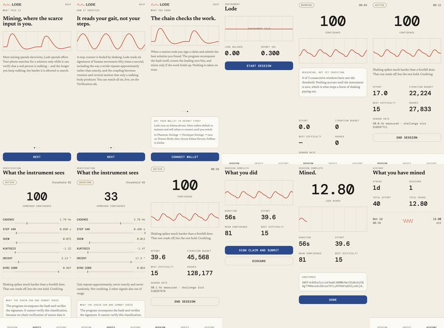

Captured from the web build, so the motion is synthetic — a browser has no
accelerometer. Every screen, every state, every figure is the real app; only
the sensor stream is generated. The mint in step 11 is a real devnet
transaction.

## Onboarding

| | |
|---|---|
| 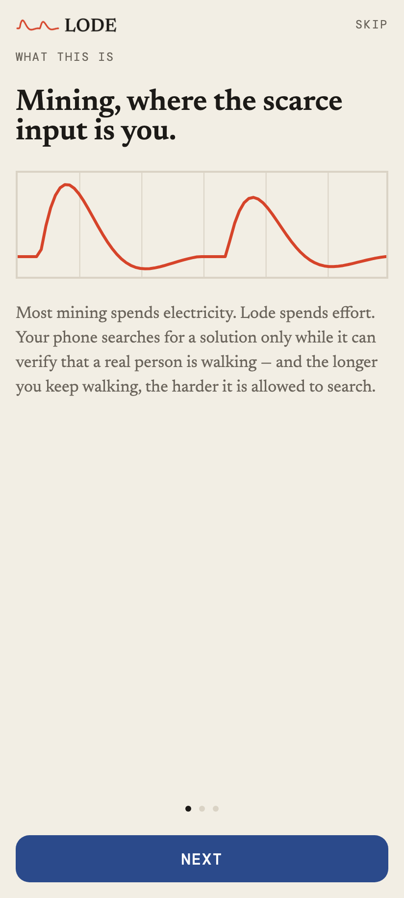 | **What this is.** Mining where the scarce input is effort rather than electricity. The waveform is the mark's own curve — two footfall impulses, the second smaller. |
| 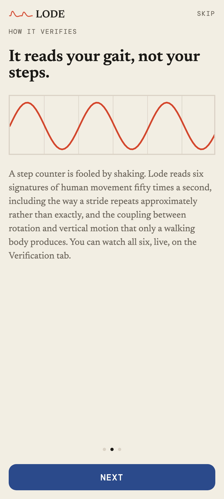 | **How it verifies.** Reads the signature of gait, not steps. Illustrated with a clean sine: what a shaken phone looks like, and why a step counter is fooled. |
| 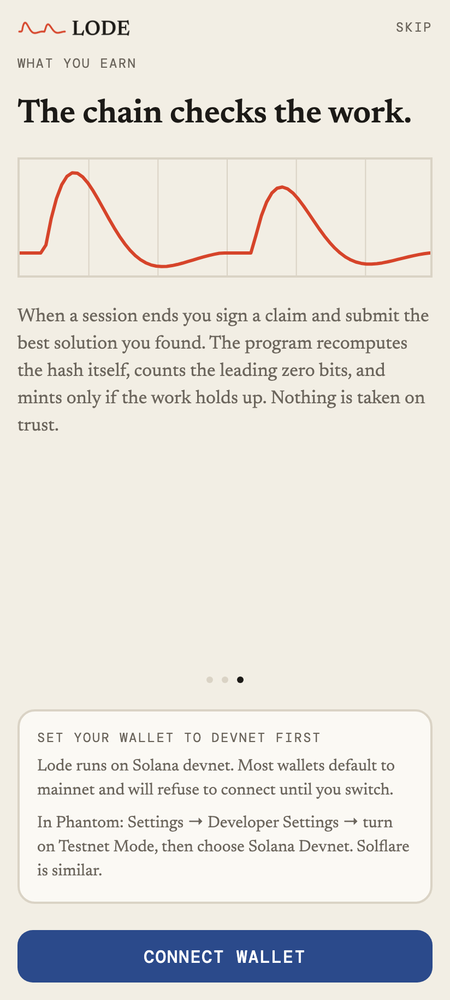 | **Connect.** The devnet instruction appears *before* the attempt. Wallets default to mainnet and refuse a devnet app, which otherwise presents as the app being broken. |

## At rest

| | |
|---|---|
| 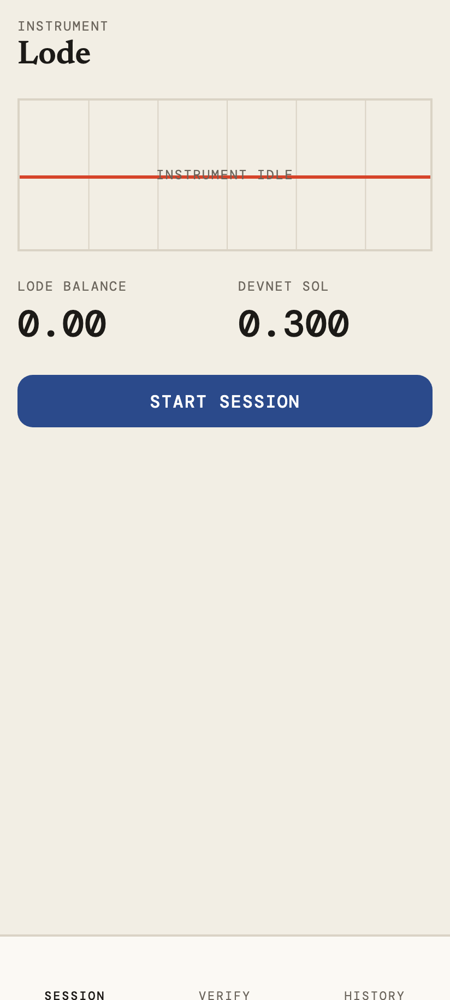 | **Home.** Balances, and a trace panel holding a flat line with "instrument idle". The empty state is designed rather than blank, because it is the second thing anyone sees. |

## A session

| | |
|---|---|
| 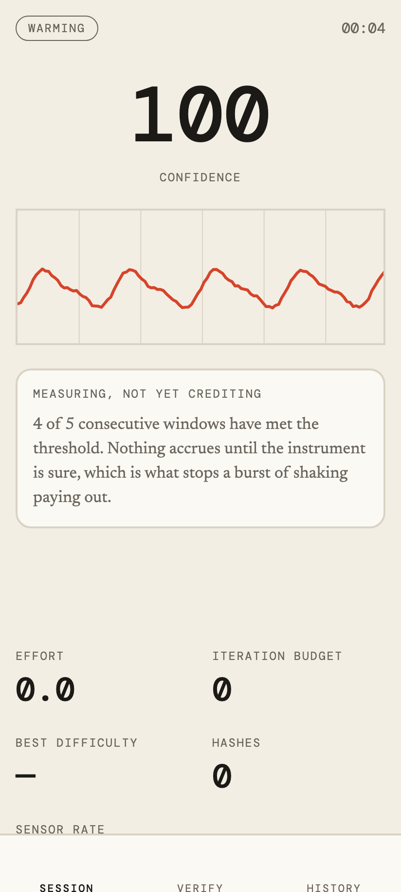 | **Warming.** Five consecutive qualifying windows are required before anything accrues, and the count is shown. Most products would hide this step; showing it is what tells a sceptical user the verification is real. |
| 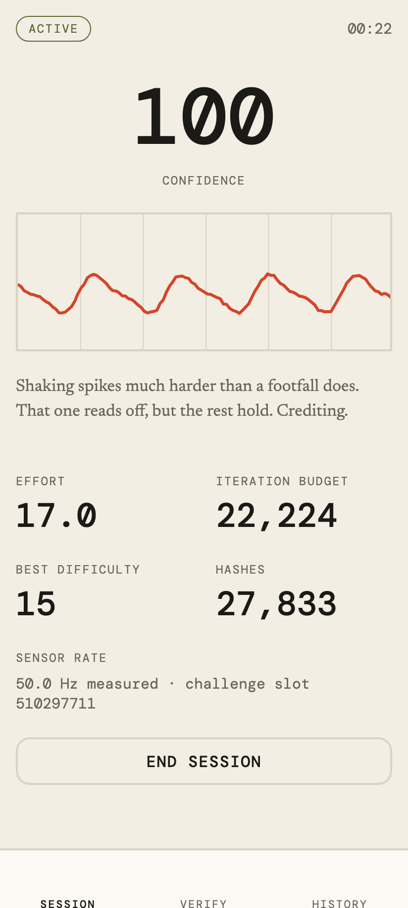 | **Crediting.** Confidence updates once a second with no animation. Effort, iteration budget, best difficulty, hashes, and the measured sensor rate. |
| 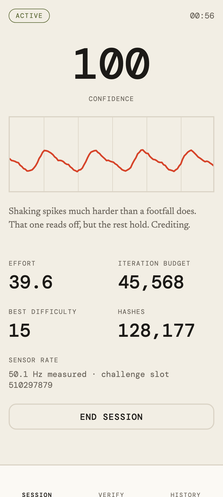 | **Mining.** The budget climbs with sustained effort — 45,568 iterations against 128,177 hashes done. That number is the mechanic made visible. |

## Verification

| | |
|---|---|
| 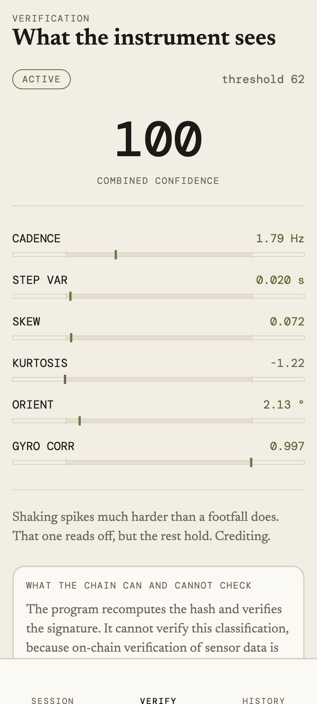 | **Walking.** Six signals, each against the band it must sit inside. Gyro correlation reads 0.997. |
| 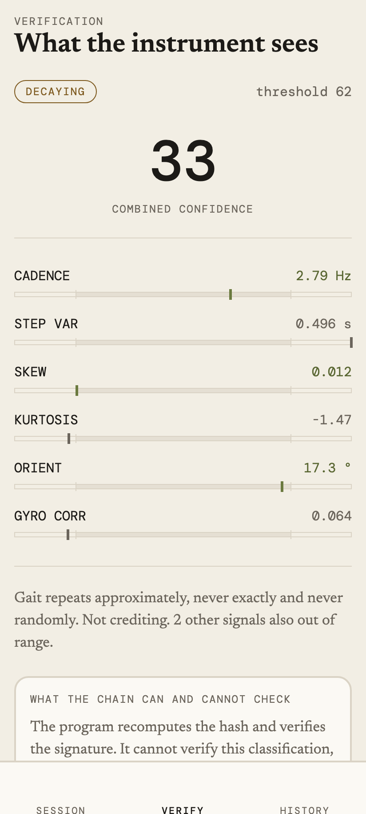 | **Shaken.** Confidence falls to 33, the state moves to decaying, and gyro correlation collapses to 0.064. A walking body rotates as it steps; a shaken phone does not. |

Both screens carry the note about what the chain can and cannot check.

## Closing out

| | |
|---|---|
| 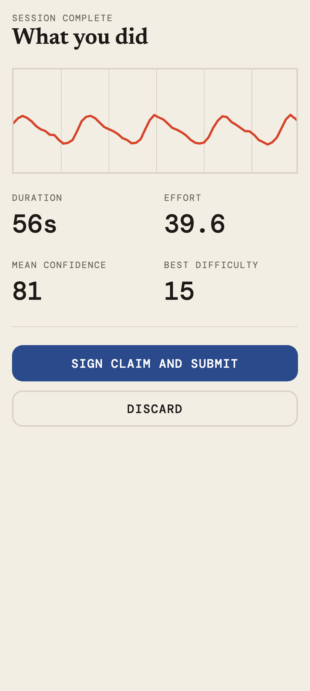 | **Summary.** Duration, effort, mean confidence, best difficulty, then sign and submit. |
| 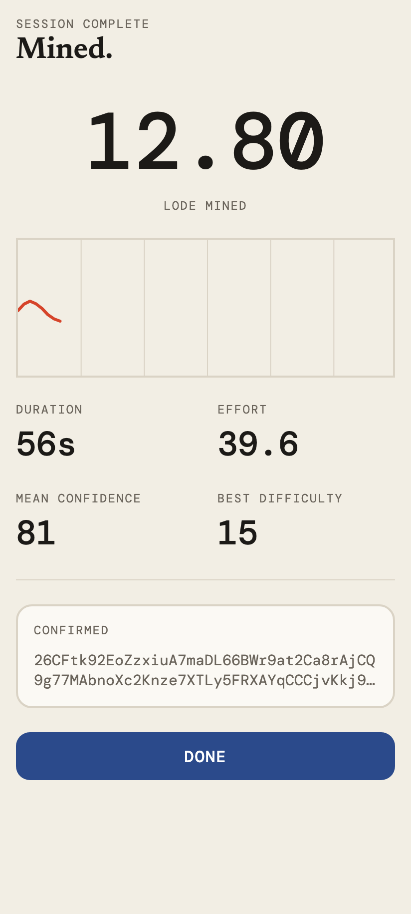 | **Mined.** 12.80 LODE for a difficulty-15 solution, with the devnet signature. The only moment the app animates: the amount arrives and the session's trace draws itself once. |
| 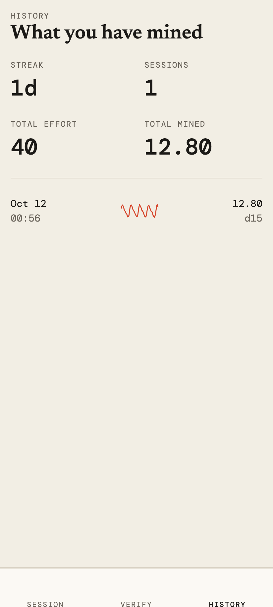 | **History.** Streak, sessions, cumulative effort and total mined, with a sparkline of each session's trace. |

## Error states

The screens that matter when something fails:

- **Program unreachable** — a card on home; sessions still run and record effort
- **No devnet SOL** — a card offering an airdrop, shown below 0.01 SOL
- **Wallet refused** — names the likely cause and carries the raw error
- **Challenge rotated mid-session** — offers to resubmit against the new one
- **No solution found** — explains that effort buys iterations, not guarantees

Every one keeps the session. The effort was real whether or not the network
cooperated, so nothing is discarded on failure.
